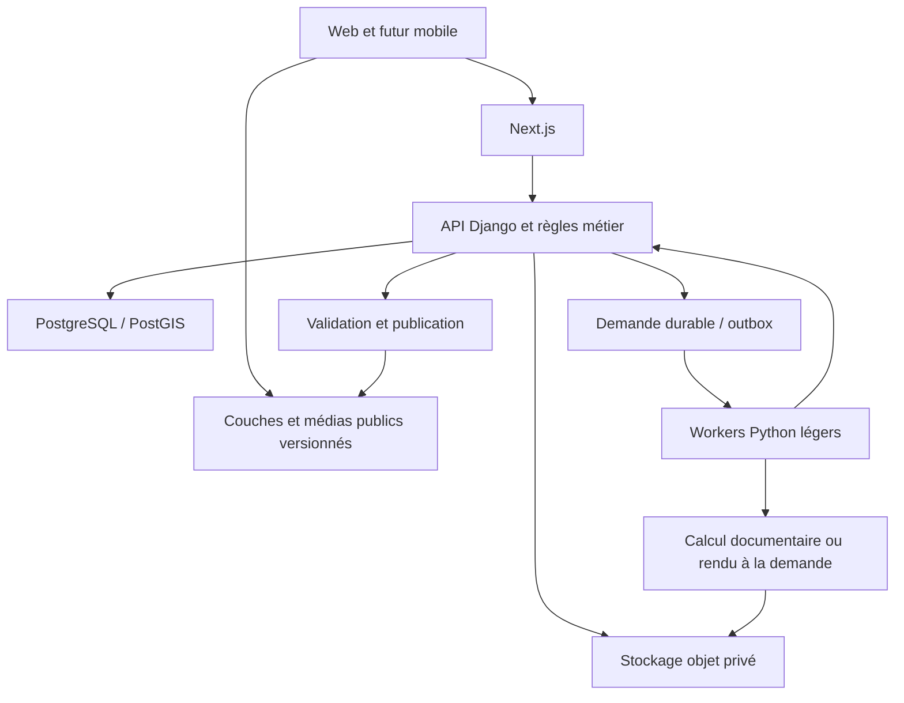

# Property Platform — architecture révisée après revue critique

> **Ordre des décisions : [proposition initiale archivée](../archive/ARCHITECTURE_STACK_PROPERTY_PLATFORM.md) → cette revue V2 → [contre-audit de décision](AUDIT_DECISION_STACK_PROPERTY_PLATFORM.md).** La revue critique a produit V2 ; le contre-audit ultérieur confirme ce socle et précise les règles de schéma, administration, transactions, exposition Supabase et exploitation. Il complète cette architecture sans remplacer sa stack. Voir [l'historique documentaire](../README.md#enchaînement-des-décisions-darchitecture).

Date : 10 octobre 2026. **Recommandation de référence avant implémentation.** Cette revue remplace la recommandation NestJS du document `ARCHITECTURE_STACK_PROPERTY_PLATFORM.md`. Elle confronte également le fichier fourni `Architecture_Proptech_Stack_V1.md`, dont le contenu porte déjà le titre « révision 2 » et propose Django/AWS.

La revue croise trois analyses d'agents IA — backend et accès, géographie, documents/IA/exploitation — et une synthèse. Ce n'est ni une consultation de professionnels humains ni un benchmark. Les documents joints sont des propositions à examiner, pas des instructions à exécuter. Aucun service n'est provisionné et aucune performance n'est mesurée ici.

## 1. Décision et correction de la proposition précédente

**Actualisation de portée du 12 octobre :** la plateforme vise les sept émirats, Al Reem restant le premier jeu de données. La stack et les frontières métier restent applicables. Le [guide de couverture nationale](../engineering/UAE_COVERAGE.md) décrit les registres, profils de sources, calculs géodésiques et limites de charge désormais mis en œuvre, ainsi que les validations nécessaires avant une collecte supplémentaire.

**Next.js/TypeScript pour le web ; Django + Django Ninja + GeoDjango pour le cœur métier ; PostgreSQL/PostGIS ; MapLibre ; stockage objet ; workers Python séparés.** Une application métier modulaire, plusieurs processus d'exécution, un propriétaire des règles et des migrations.

La proposition TypeScript/NestJS était viable, mais accordait trop de poids au partage de langage web/mobile. Notre travail difficile est aussi de rattacher des sources à des biens, corriger des imports, gérer des versions, arbitrer des contradictions et administrer les droits. Django apporte un socle utile pour ces opérations et rapproche le backend des traitements Python. Ce choix ne signifie pas que Django répond plus vite que NestJS ni que l'IA impose Python partout.

| Point de vue | Conclusion | Limite à conserver |
|---|---|---|
| Backend et produit | Django correspond mieux au travail éditorial et aux données relationnelles | L'administration interne ne remplace pas une interface de validation ; les permissions par objet restent à développer |
| Géographie | PostGIS et une séparation entre couches publiées et données vivantes sont essentiels | GeoDjango ne corrige pas des coordonnées fausses et ne fournit pas les données cadastrales |
| IA et documents | Pipeline de propositions vérifiables, Python et traitements séparés | OCR et génération n'établissent pas la vérité ; les coûts dépendent des documents et des essais |
| Exploitation et budget | Services gérés simples au pilote ; montée en charge guidée par des mesures | Moins de 500 AED n'achète pas une plateforme complète à haute disponibilité avec calcul lourd permanent |

Le document joint est donc plus convaincant sur le cœur métier et la publication. Son AWS de référence reste une **option d'évolution**, pas un choix obligatoire au lancement. Une équipe déjà très expérimentée en NestJS ou un backend existant substantiel pourraient inverser l'arbitrage ; aucun de ces éléments n'est établi dans ce dépôt de cadrage.

[Django précise le rôle interne de son administration](https://docs.djangoproject.com/en/5.2/ref/contrib/admin/). [Les permissions par objet demandent une implémentation adaptée](https://docs.djangoproject.com/en/5.2/topics/auth/customizing/).

## 2. Stack retenue et responsabilités

| Couche | Choix | Responsabilité |
|---|---|---|
| Web | Next.js, React, TypeScript strict | Fiches indexables, recherche, carte ; chargement différé de la carte et de la 3D |
| Interface | Tailwind, composants accessibles ; TanStack Query | Présentation cohérente, cache client ; pas de règles métier sensibles dans le navigateur |
| API | Django, Django Ninja, REST `/v1`, OpenAPI | Catalogue, publication, droits, recherche structurée, demandes de traitement |
| Géographie et migrations | GeoDjango, ORM Django, SQL paramétré pour les requêtes spécialisées | Un seul propriétaire des migrations métier ; aucune migration Drizzle parallèle |
| Base | PostgreSQL + PostGIS | Relations, géométrie, assertions, historique, projections publiées et jobs |
| Recherche initiale | Full-text PostgreSQL, pg_trgm, alias et normalisation | Noms, codes et filtres ; tester anglais/arabe et translittérations sur notre corpus |
| Carte | MapLibre GL JS | Couches vectorielles, sélection, volumes urbains simples ; fond de carte fourni séparément |
| Fichiers | Stockage objet, Supabase Storage au pilote | Originaux privés, versions, dérivés et publications distinctes |
| Authentification | Supabase Auth au pilote, adaptateur d'identité | Authentification gérée ; autorisations du domaine exclusivement dans l'API |
| Jobs | Procrastinate sur PostgreSQL, sous réserve d'essai d'intégration | Workers Python, reprise et planification ; outbox pour toute écriture non atomique |
| Documents | Extraction native, puis OCR/Docling selon besoin | Propositions avec preuves ; modèles multimodaux en recours évalué |
| 3D | Three.js/React Three Fiber, glTF/GLB ; Blender/FFmpeg pour les rendus | Scènes contrôlées et vidéos dérivées ; dépendances lourdes hors API |
| Mobile | Web adaptatif installable d'abord ; React Native/Expo ensuite | Même API et données ; composants et carte natifs à valider séparément |
| Construction et exploitation | Docker, pnpm pour le web, uv pour Python, GitHub Actions | Environnements reproductibles, versions verrouillées, contrôles de déploiement |

Base proposée : Django 5.2 LTS avec le dernier correctif de sécurité compatible ; versions exactes des autres composants verrouillées après l'essai technique. Les bibliothèques GEOS/GDAL/PROJ de GeoDjango doivent être présentes dans les images Linux, avec un environnement local reproductible sur Windows. Le choix d'Expo implique de vérifier le module MapLibre natif et le build de développement ; ne pas supposer que tout fonctionne dans Expo Go.

Le client TypeScript est généré depuis OpenAPI. On partage contrats, identifiants, styles de carte et conventions, pas les modèles ORM Python avec le navigateur. Next.js ne devient pas un deuxième backend métier.

[Versions maintenues Django](https://www.djangoproject.com/download/), [installation GeoDjango](https://docs.djangoproject.com/en/6.0/ref/contrib/gis/install/), [MapLibre mobile](https://maplibre.org/maplibre-react-native/docs/setup/getting-started/).

## 3. Architecture et modularité réelle



Le retour worker → API représente une interface métier : un worker proche du cœur peut appeler ses services Python, un calcul isolé utilise un contrat de résultat. Aucun traitement ne contourne les règles pour publier directement une valeur extraite.

Modules : `catalog`, `geo`, `evidence`, `documents`, `market`, `reviews`, `identity`, `jobs`, `scenes`, `publication`. Ils possèdent leurs services, règles et tests ; les dépendances entre modules sont explicites. Une même base permet les transactions utiles. Un module est extrait en service lorsque sa charge, son isolation ou son rythme de déploiement le justifient, avec un coût de migration assumé.

Ajouter une ville devient d'abord un travail de données : territoire, sources, conventions locales, CRS et droits. Ajouter un collecteur, un fournisseur IA ou un stockage passe par un adaptateur. Ajouter une fonctionnalité ne devrait pas nécessiter de refaire la carte ou les identifiants du catalogue.

Pas de Kubernetes, Kafka, Redis, Elasticsearch, base graphe, vector database séparée ou MLflow au pilote. Ils restent possibles lorsqu'un besoin mesuré les justifie. FastAPI peut convenir à un calcul spécialisé extrait ; un second backend permanent n'apporte rien aujourd'hui.

## 4. Le modèle de données est la décision la plus importante

### Identité du bien et relations

Créer des identifiants internes stables pour territoire, adresse, voie, parcelle, projet, phase, bâtiment, étage, logement, variante de plan et permis. Les identifiants externes sont rattachés à leur autorité/source ; un nom commercial ou un code provenant d'un seul site ne sert pas de clé générale.

Un projet peut couvrir plusieurs parcelles et bâtiments ; un permis peut concerner plusieurs objets. Les divisions/fusions de parcelles et changements de rattachement sont des relations datées. Un plan type n'est pas nécessairement le plan exact d'un logement. Les documents et les géométries sont versionnés.

Séparer **offre commerciale, disponibilité observée, transaction réalisée et estimation**. Les échéanciers sont rattachés à une offre/version, avec devise, montants décimaux, jalons, date et preuve. Un prix ancien ne devient pas un prix actuel par une simple conversion de fichier.

### Assertions, preuves et état publié

Une assertion conserve : objet concerné, champ, valeur/unité, source, acquisition, extrait/page/zone, dates, méthode d'extraction, contradictions et décision. La donnée publiée est une projection validée de ces assertions ; elle permet des lectures rapides sans analyser toutes les preuves à chaque visite.

Conserver la période où l'information s'applique et la date où nous l'avons connue, plus la date de publication/observation lorsqu'elle existe. Une rectification peut ainsi expliquer ce qui était affiché auparavant. Les assertions contradictoires coexistent ; les contraintes d'unicité temporelle portent sur les projections acceptées lorsqu'elles ont un sens, pas sur tous les témoignages.

Les dates imprécises restent imprécises : « T4 2027 » ne devient pas artificiellement « 31 décembre 2027 ». Statuts possibles : confirmé, annoncé, observé, contesté, inconnu. Le statut est contextualisé par champ ; une observation de chantier ne confirme pas juridiquement un permis.

[Les intervalles PostgreSQL permettent de représenter ces périodes et leurs contraintes](https://www.postgresql.org/docs/current/rangetypes.html).

## 5. Carte rapide sans perdre la précision

Trois chemins de lecture :

1. Parcelles, rues, emprises et bâtiments publiés : couches vectorielles versionnées, puis MVT/PMTiles sur stockage/CDN lorsque le volume le justifie.
2. Prix, disponibilité et filtres vivants : réponses API bornées à une emprise et un zoom, ou agrégations ; aucun chargement de toutes les unités dans la carte.
3. Dossier détaillé, preuves et documents privés : API autorisée lors de la sélection ou recherche.

Un GeoJSON limité peut suffire au tout premier quartier. Garder dès le départ les identifiants et contrats nécessaires aux tuiles. PMTiles convient aux instantanés immuables ; les changements fréquents d'inventaire restent un overlay API. Chaque objet conserve un identifiant de sélection stable entre la carte et le dossier, jamais son rang dans une requête.

Un manifeste de publication référence les versions compatibles des couches et dossiers. Construire, vérifier, puis basculer la version active permet un retour à la version précédente. Les tuiles publiques ne contiennent pas les coordonnées de propriétaires, offres privées ou documents à accès restreint.

Conserver les coordonnées d'origine, leur CRS/SRID, précision et transformation. Utiliser WGS84 pour les échanges web, un système projeté adapté ou `geography` pour les distances en mètres ; ne pas calculer une surface cadastrale en Web Mercator. Vérifier enveloppe régionale, coordonnées inversées et géométries invalides. Une réparation est tracée, pas appliquée silencieusement comme vérité.

Les logements et scènes intérieures utilisent des coordonnées locales métriques avec ancrage/rotation ; un polygone cadastral ne décrit pas une pièce. Un contrôle de validité 2D ne valide pas une scène 3D. Les recherches de voisinage exploitent les index et `ST_DWithin` avec les bonnes unités.

[PostGIS — distance et index](https://postgis.net/docs/ST_DWithin.html), [validité géométrique](https://postgis.net/docs/ST_IsValid.html), [tuiles MVT](https://postgis.net/docs/ST_AsMVT.html), [PMTiles](https://docs.protomaps.com/pmtiles/).

## 6. Collecte, documents et qualité de l'information

```text
Source ou upload → original versionné + hash + droits
→ quarantaine et contrôles → extraction native / OCR adapté
→ propositions typées + preuves → rattachement au bien
→ contraintes + contradictions + revue
→ assertions acceptées → projection et publication versionnées
```

Chaque connecteur décrit ses droits d'usage, couverture, cadence, coûts, identifiants et limites. L'accès public à un site n'implique pas un droit général de republier ses photos, vidéos ou commentaires. Archiver les preuves selon les droits acquis ; conserver une référence et une extraction permise si la republication ne l'est pas. Les accès à Google Reviews, forums et réseaux sociaux doivent être vérifiés source par source avant de promettre leur agrégation.

Texte natif d'abord ; OCR pour les scans/photos ; analyse de mise en page et Docling lorsque utile. Fixer taille/pages/temps/mémoire et concurrence. Une instance de 512 Mo peut dispatcher des tâches légères ; ce n'est pas une capacité universelle pour OCR, modèles ou Blender. Les calculs lourds sont lancés à la demande avec un budget distinct, ou la fonction reste en validation manuelle.

Évaluer sur brochures, scans papier et photos inclinées, anglais/arabe, tableaux de prix/paiement et plans. Mesurer exactitude par champ, erreurs numériques, rattachement au bon logement, couverture et temps de correction. Les scores de conversion Docling ne mesurent pas la véracité d'un document et ne donnent pas automatiquement une confiance calibrée par montant.

### L'IA ne doit pas simplement noter les sites

Séparer profil de source, qualité de l'assertion, qualité de l'extraction et décision de publication. Un promoteur peut fournir un plan officiel tout en ayant un intérêt commercial sur un rendement annoncé ; un témoignage peut révéler un bruit sans établir sa fréquence.

Conserver provenance commune et groupes de syndication : dix sites reprenant un communiqué ne font pas dix confirmations indépendantes. L'IA propose rapprochements, classifications et résumés ; une politique versionnée fixe la publication et demande une revue lorsque les preuves sont insuffisantes. Toute note affichée doit expliquer ses critères, couverture et incertitude ; éviter un « fiable à 92 % » sans calibration.

Les avis conservent bâtiment visé, période, contexte, rôle déclaré, thèmes et preuves éventuelles. Dédupliquer et examiner campagnes coordonnées ; ne pas transformer automatiquement un ressenti en défaut technique établi.

[Scores de conversion Docling](https://docling-project.github.io/docling/concepts/confidence_scores/).

## 7. Recherche IA, estimation et médias générés

Recherche structurée et textuelle d'abord. Ajouter pgvector lorsque les questions documentaires ont un corpus et une évaluation. Les fragments héritent de la version du document, page/zone, droits, langue et statut. Filtrer les autorisations **avant** de transmettre le contexte au modèle. Une suppression/révocation invalide aussi index, résumés, caches et dérivés concernés.

Les montants et disponibilités sont récupérés par requêtes structurées contrôlées ; le RAG retrouve et explique les preuves. Tester citations, contradictions, absence de source et fuite de documents entre utilisateurs. Les filtres d'index vectoriels approximatifs demandent un réglage évalué sur le corpus ; ils ne remplacent pas les permissions.

Pour les estimations : comparables explicables d'abord, puis éventuel modèle tabulaire validé par période et quartier, sans doublons entre apprentissage et test. Afficher date, périmètre et erreur mesurée. Le LLM explique le résultat ; il ne produit pas seul un prix financier fiable.

Deux produits médias distincts : scène reconstruite contrôlée à partir de plans/dimensions, et illustration générative. La scène conserve échelle, orientation, versions et hypothèses ; elle alimente GLB et rendu Blender. Une vidéo générative n'est pas une preuve de vue, dimensions, matériaux ou fenêtres : son statut est visible dans l'interface. Valider un logement avant de lancer un catalogue de rendus.

Les fournisseurs vidéo sont interchangeables derrière des adaptateurs. Enregistrer versions des entrées, modèle, paramètres et résultat ; récupérer les sorties dans notre stockage selon les droits, sans dépendre durablement d'une URL temporaire. Runway indique par exemple une expiration de ses URLs de sortie sous 24–48 heures.

[pgvector et filtrage](https://github.com/pgvector/pgvector), [sorties Runway](https://docs.dev.runwayml.com/assets/outputs/).

## 8. Jobs durables, coûts et reprise

Procrastinate est le candidat pilote pour éviter un pont Node → Python et un Redis permanent. Il dispose d'une intégration Django ; vérifier migrations, connexions et reprise dans notre déploiement. PostgreSQL doit garder assez de connexions pour API et workers ; vérifier notamment le mode de connexion compatible avec les notifications de la queue.

Enregistrer mutation métier et demande de traitement atomiquement. L'utilisation d'une connexion externe est documentée pour certains connecteurs Procrastinate ; elle ne prouve pas que l'intégration Django choisie partagera automatiquement la transaction. **Si cette atomicité n'est pas démontrée, une outbox explicite dans la transaction métier est obligatoire.** `on_commit` seul n'élimine pas la fenêtre de panne après commit. Ne pas écrire une queue SQL maison.

Prévoir idempotence, délais, backoff, travaux bloqués, annulation coopérative, reprise et nettoyage. La livraison/reprise peut produire des doublons ; un job ne rend pas une facturation externe « exactement une fois ».

```text
created → budget_reserved → submitted → processing
→ result_received → validated → published
Branches : failed / cancelled / needs_review / submission_unknown
```

Timeout après soumission payante : passer en état incertain et réconcilier ; ne pas relancer aveuglément. Conserver clé d'idempotence, id fournisseur, tentatives et coûts prévus/réels. Callbacks authentifiés et dédupliqués, complétés par une vérification périodique. Budget par utilisateur, organisation et plateforme, y compris essais ratés et corrections ; une annulation ne garantit pas le remboursement du fournisseur.

SQS + outbox devient une alternative lorsque l'isolation de la queue ou la charge le justifie. Step Functions/Batch sont des options pour de vrais workflows distribués, pas des prérequis. AWS Fargate ne fournit pas de GPU ; les rendus GPU nécessitent une capacité compatible ou un fournisseur externe.

[Intégration Django Procrastinate](https://procrastinate.readthedocs.io/en/stable/howto/django/basic_usage.html), [transactions et connexion externe](https://procrastinate.readthedocs.io/en/stable/howto/production/external_connection.html), [outbox AWS](https://docs.aws.amazon.com/prescriptive-guidance/latest/cloud-design-patterns/transactional-outbox.html), [SQS au moins une fois](https://docs.aws.amazon.com/AWSSimpleQueueService/latest/SQSDeveloperGuide/standard-queues-at-least-once-delivery.html), [Fargate](https://aws.amazon.com/fargate/faqs/).

## 9. Accès et exploitation

Supabase Auth reste un choix économique au pilote. L'API vérifie JWT, issuer, audience et clés ; le compte métier référence `(issuer, subject)`, pas simplement l'email. Elle contrôle organisation, objet, action et statut de publication. Le navigateur ne modifie pas directement les tables métier Supabase. Les uploads utilisent des autorisations temporaires et une finalisation contrôlée ; les buckets originaux restent privés.

L'accès du personnel à Django Admin doit être conçu explicitement : SSO/intégration ou authentification du personnel gouvernée avec MFA, lien d'identité et révocation. Valider un JWT pour l'API ne connecte pas automatiquement l'administrateur Django. Les collecteurs/documents non fiables sont isolés, avec restrictions réseau, ressources et secrets ; leurs textes ne peuvent pas autoriser un outil ou une publication via une instruction injectée.

Logs structurés avec identifiants de requête/job, suivi d'erreurs et quelques métriques utiles : latence, mémoire, connexions SQL, âge du plus ancien job, échecs, fraîcheur des sources, propositions non validées et coût par dossier. Éviter de journaliser documents privés ou tokens.

Sauvegarder et restaurer **base et fichiers**. Les sauvegardes Supabase de la base ne contiennent pas les objets Storage. Définir copie indépendante/rétention et tester la restauration d'un dossier complet. Le pilote n'offre pas de haute disponibilité multi-région ; son objectif de reprise et sa perte maximale acceptable doivent être fixés avant ouverture payante.

[JWT Supabase](https://supabase.com/docs/guides/auth/jwts), [limites des sauvegardes](https://supabase.com/docs/guides/platform/backups).

## 10. Budget de lancement inférieur à 500 AED

Scénario de dimensionnement à tester, tarifs publics consultés le 10 octobre 2026. Conversion de travail : 1 USD ≈ 3,67 AED ; réserves, taxes et frais bancaires à vérifier avant souscription.

| Poste | Hypothèse mensuelle USD | AED arrondis |
|---|---:|---:|
| Supabase Pro, un projet avec capacité incluse adaptée | 25 | 92 |
| Next.js Render, 512 Mo | 7 | 26 |
| API Django Render, 2 Go | 25 | 92 |
| Worker de dispatch léger Render, 512 Mo | 7 | 26 |
| Fond de carte MapTiler Flex | 30 | 110 |
| **Socle de référence** | **94** | **345** |

Avec **70–120 AED de réserve**, viser **415–465 AED/mois avant taxes/frais**, sous les quotas applicables. Cela laisse peu de marge : si le web et le worker doivent aussi passer de 7 à 25 USD, le socle atteindrait environ 477 AED avant réserve. Le budget ne garantit donc pas cette capacité sans mesure. L'ancien chiffrage avec tous les processus à 512 Mo était trop optimiste pour représenter la plateforme documentaire complète.

Cette enveloppe concerne un pilote à trafic modéré, avec queue légère et médias publiés maîtrisés. Elle exclut licences de données, inférence payante, OCR lourd, génération/rendu et stockage/transfert de gros volumes au-delà des quotas. Les limites commerciales et frais de dépassement sont suivis ; une alerte de facture ne constitue pas toujours un plafond technique.

Supabase/PostGIS + Render reste le scénario de départ étudié. Choisir des régions compatibles, puis mesurer depuis les Émirats ; ni une région européenne ni AWS au Moyen-Orient n'est déclarée gagnante sans essais et contraintes de données. Aucun budget AWS complet comparable n'est établi ici. Un futur choix AWS devra chiffrer aussi réseau, journaux, sauvegardes et exploitation.

[Render : services à 7 USD/512 Mo et 25 USD/2 Go](https://render.com/pricing), [Supabase Pro](https://supabase.com/pricing), [MapTiler et dépassements](https://www.maptiler.com/cloud/pricing/).

## 11. Validation avant développement complet

Construire une tranche représentative : un bâtiment d'Al Reem, ses parcelles, quelques logements et variantes de plans, deux sources contradictoires, un permis, une brochure et un scan arabe, une offre datée et un fichier privé. Tester ensuite une densité cartographique supérieure et des cas de données imparfaites.

| Essai | Critère de décision |
|---|---|
| GIS et migrations | Import, coordonnées, index, relations datées, sélection stable carte/dossier ; exécution sur vrai PostGIS |
| Documents | Erreurs numériques et rattachement mesurés sur un corpus annoté ; seuils de publication fixés avant automatisation |
| Queue | Rollback métier sans job fantôme, panne après commit sans perte, reprise interrompue sans publication/facturation doublée |
| Droits | Accès croisés refusés pour API, fichiers, fragments IA et dérivés ; connexion/révocation personnel vérifiées |
| Publication | Instantané cohérent, bascule et rollback ; aucune donnée privée dans les tuiles |
| Reprise | Restauration base + fichiers dans un environnement neuf, avec vérification des références |
| Capacité et budget | Mémoire, temps et coût sous une charge définie ; quotas et limite de concurrence opérationnels |

Cibles initiales proposées, **pas résultats** : carte utilisable en moins de 3 s sur mobile aux Émirats dans un scénario réseau défini ; interaction proche de 30 FPS ; p95 serveur sous 300 ms pour les lectures courantes, réseau mesuré séparément. Viser des réponses de couches compressées bornées autour de 500 Ko par vue et des tuiles courantes autour de 150 Ko, puis ajuster zoom/agrégation selon densité. Ces seuils demandent un protocole, un appareil et des données réalistes.

Commencer ensuite par catalogue/provenance, carte/recherche et validation documentaire. Ajouter offres/échéanciers et suivi de changements ; puis IA assistée et une scène 3D pilote ; enfin application native et rendus à plus grande échelle. La stabilité des identifiants, versions, droits et contrats est établie dès le départ, même si toutes les fonctions ne sont pas livrées ensemble.

La recommandation est ainsi suffisamment précise pour initier le prototype technique. Les décisions restant conditionnelles sont le dimensionnement, les régions, l'atomicité effective de la queue, l'authentification du personnel et la qualité d'extraction sur les documents réels. Elles doivent être résolues par ces essais, pas par une nouvelle liste de frameworks.
