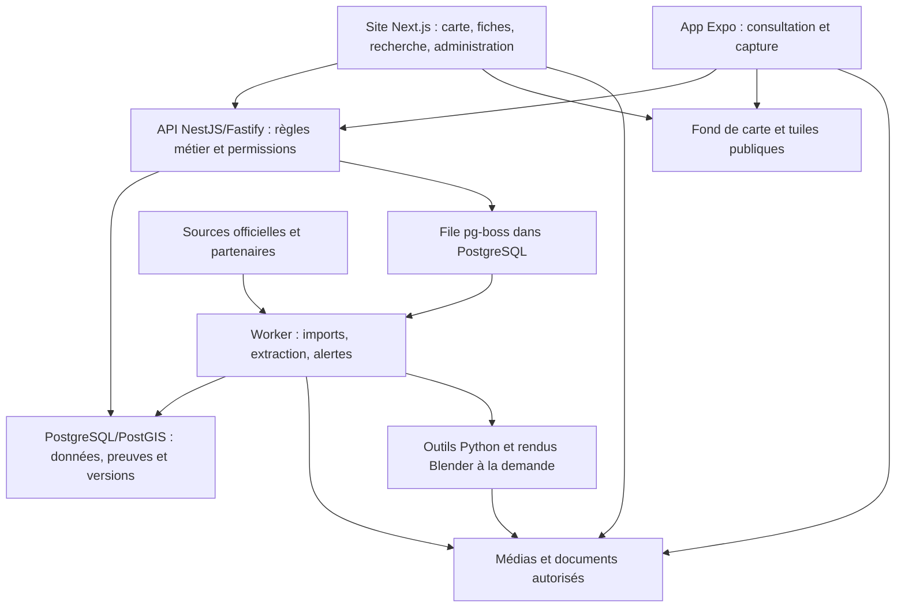

# Liwa Atlas — stack et architecture recommandées

> **Document historique, remplacé après revue critique.** La recommandation actuelle est [la revue d'architecture V2](../architecture/REVUE_ARCHITECTURE_LIWA_ATLAS_V2.md) : Next.js, Django/GeoDjango, PostgreSQL/PostGIS et workers Python. Le contenu ci-dessous conserve la proposition précédente pour rendre l'évolution des décisions traçable ; son budget et ses choix ne constituent plus la référence.

Cette proposition constitue la **V1 du dépôt**. La revue critique a ensuite produit V2 ; un [contre-audit ultérieur](../architecture/AUDIT_DECISION_STACK_LIWA_ATLAS.md) a confirmé V2 et précisé ses conditions de validation. Voir [l'enchaînement complet](../README.md#enchaînement-des-décisions-darchitecture).

Date : 10 octobre 2026. Budget demandé : moins de 500 AED/mois d’infrastructure au lancement, hors licences de données immobilières et génération de médias. Statut : recommandation documentée avant implémentation ; performances et coûts réels restent à mesurer. Aucun service payant n’a été souscrit.

## 1. Décision proposée

Une plateforme principalement en **TypeScript**, avec **Next.js** pour le site, **NestJS/Fastify** pour l’API métier, **PostgreSQL/PostGIS** pour les données, **MapLibre** pour la carte et **React Native/Expo** pour le mobile. Les traitements de documents et médias passent par un worker séparé. Python intervient pour les outils spécialisés, au moment où un besoin validé le justifie.

Le backend est un **monolithe modulaire** : une application métier organisée en modules, qui peut ensuite être répartie en services si les mesures l’exigent. Le site, l’API et le worker sont des processus distincts ; cela ne nécessite pas de transformer chaque fonction en microservice.

Cette proposition optimise un compromis : vitesse de développement, lisibilité, coût d’exploitation et capacité à traiter les données spatiales. Ce n’est pas une affirmation que ces frameworks sont les plus rapides sur tous les benchmarks. Pour notre produit, le poids des géométries/médias, les requêtes SQL et la latence réseau seront des facteurs déterminants.

## 2. Stack par fonction

| Fonction | Choix recommandé | Raison et limite |
|---|---|---|
| Langage principal | TypeScript strict, Node.js LTS compatible avec les dépendances | Contrats et logique réutilisables entre web, API et mobile ; les calculs lourds ne tournent pas dans une requête HTTP |
| Site et interface éditoriale | Next.js App Router, React | Fiches rendues côté serveur, référencement et navigation interactive ; carte et 3D chargées côté client selon besoin |
| Interface web | Tailwind CSS et composants accessibles, basés sur Radix/shadcn si utiles | Construction cohérente et contrôle de l’interface ; sélectionner les composants nécessaires |
| API métier | NestJS avec adaptateur Fastify, REST/OpenAPI | Modules explicites, validation, permissions et contrat utilisable par le mobile |
| Contrats et validation | Schémas Zod partagés et documentation OpenAPI | Valider les entrées à l’exécution ; éviter des DTO et schémas qui divergent |
| Accès aux données | Drizzle pour les tables classiques ; SQL paramétré pour PostGIS | Garder le contrôle des requêtes spatiales ; ne pas supposer une prise en charge ORM complète de tous les polygones |
| Base | PostgreSQL et extension PostGIS, index GiST | Relations immobilières, historique, filtres géographiques et voisinage dans une même base |
| Recherche initiale | PostgreSQL full-text et pg_trgm, avec noms/alias normalisés | Recherche de projets, codes et variantes sans moteur séparé ; qualité multilingue à tester |
| Carte web | MapLibre GL JS, couches vectorielles | Affichage WebGL, parcelles, bâtiments et volumes ; le moteur ne fournit pas à lui seul le fond de carte |
| Carte mobile | MapLibre React Native dans une app Expo | Même famille de styles/données ; composants et comportements natifs à tester séparément |
| Données côté client | TanStack Query ; état d’interface local ou Zustand si nécessaire | Cache des requêtes, synchronisation et annulation ; séparer données métier et état visuel |
| Authentification initiale | Supabase Auth ; permissions métier dans l’API | Éviter de développer la gestion de mots de passe ; isoler l’intégration pour permettre une migration |
| Documents et médias | Supabase Storage au pilote, abstraction de stockage objet | Originaux, versions et rendus ; objets privés distincts des médias publiables |
| Imports et tâches | pg-boss sur PostgreSQL, worker Node séparé | File durable et reprises sans ajouter un serveur Redis au pilote |
| Extraction spécialisée | Python appelé par le worker, si nécessaire | Bibliothèques adaptées aux PDF, images et données géographiques ; contrôle humain pour les extractions critiques |
| Visites 3D web | Three.js, éventuellement React Three Fiber, modèles glTF/GLB | Scène de logement et interaction ; moteur distinct de la carte urbaine |
| Production de scènes/vidéos | Blender automatisable, traitements à la demande | Partir d’une géométrie contrôlée ; budget de rendu séparé de l’hébergement courant |
| Organisation du code | Monorepo pnpm ; Turborepo quand plusieurs applications en bénéficient | Partager contrats/configuration et construire les applications séparément |
| Exploitation | Docker, GitHub Actions, logs structurés, suivi d’erreurs | Déploiements reproductibles, contrôles avant fusion et visibilité sur les erreurs |

Les versions exactes seront épinglées lors de l’initialisation, après un test de compatibilité. On utilisera les versions stables compatibles ; une version bêta ou une mise à jour majeure n’apporte pas automatiquement une meilleure plateforme.

Sources techniques : [Next.js — serveur/client](https://nextjs.org/docs/app/getting-started/server-and-client-components), [chargement différé](https://nextjs.org/docs/app/guides/lazy-loading), [NestJS/Fastify](https://docs.nestjs.com/techniques/performance), [Drizzle/PostGIS](https://orm.drizzle.team/docs/guides/postgis-geometry-point), [index spatiaux PostGIS](https://postgis.net/documentation/faq/spatial-indexes/), [MapLibre](https://maplibre.org/maplibre-gl-js/docs/), [MapLibre mobile](https://maplibre.org/maplibre-react-native/docs/setup/getting-started/), [pg-boss](https://github.com/timgit/pg-boss), [recherche PostgreSQL](https://www.postgresql.org/docs/current/textsearch.html), [pg_trgm](https://www.postgresql.org/docs/current/pgtrgm.html).

## 3. Architecture de circulation des données



La consultation lit des données déjà préparées. L’ouverture d’une fiche ne déclenche pas un scraping, un OCR ou une génération vidéo. Un import passe par réception, extraction, rapprochement, validation et publication. Les traitements peuvent être suivis sans garder une requête ouverte pendant plusieurs minutes.

Le site ne duplique pas le métier dans ses propres routes serveur. Il peut servir d’intermédiaire pour la session ou le rendu, mais les règles d’offres, preuves et publication appartiennent à l’API commune. Le mobile utilise cette même API.

Une notification ou une génération peut être rejouée après panne : les jobs doivent être idempotents. Le fait d’utiliser une file durable ne garantit pas qu’un effet externe, comme un email, ne sera jamais dupliqué. Prévoir identifiants de traitement, reprises bornées et suivi des échecs.

Le worker Node consomme pg-boss. Les outils Python exécutent des opérations spécialisées via une interface contrôlée ; on ne supposera pas qu’un worker Python peut consommer directement cette bibliothèque Node. Le mode d’exécution dépendra du poids du traitement : sous-processus limité pour une extraction simple, conteneur ou service à la demande pour une tâche lourde.

## 4. Modularité du métier

| Module | Responsabilité |
|---|---|
| Territoires et géographie | Zones, parcelles, géométries, bâtiments, adresses, relations et identifiants historiques |
| Catalogue immobilier | Projets, phases, étages, colonnes, plans types, unités et équipements |
| Preuves | Sources, affirmations, extraits, dates, contradictions, validation et droits |
| Offres | Prix, disponibilité, source commerciale, échéanciers et validité |
| Documents et médias | Originaux, pages, versions, extractions et rendus publiables |
| Observations et retours | Contributions, thèmes, périodes, modération et réponses |
| Suivi | Favoris, changements pertinents, préférences et notifications |
| Scènes 3D | Géométrie, orientation, hypothèses, niveau de détail et versions |
| Identité et accès | Utilisateurs, organisations, rôles et accès aux documents privés |
| Collecte | Connecteurs, runs d’import, déduplication, qualité et fraîcheur |

Ces modules exposent des services explicites. Un connecteur n’écrit pas librement dans toutes les tables ; il produit un résultat validé par le module concerné. Un adaptateur fournisseur permet de remplacer une source sans réécrire les fiches.

Le modèle n’utilise pas un document JSON unique comme base de tout le produit. Les identités, liens, offres et versions structurées sont des tables relationnelles. JSONB convient aux charges brutes d’import et extensions variables. Les affirmations de preuve complètent ce modèle sans remplacer toutes les contraintes métier par un système générique difficile à contrôler.

Un projet peut occuper plusieurs parcelles et une parcelle plusieurs bâtiments : ces relations ne doivent pas être forcées en un lien unique. Les lieux de vente restent distincts des lieux de construction. Les données conservent objet, portée, source, validité et date de vérification.

Les territoires portent leurs conventions : langues, unités, fuseau horaire, monnaie, identifiants et connecteurs. Les règles propres à Reem ne sont pas dispersées dans le code de l’interface. Les montants utilisent un type décimal et une monnaie ; une mesure conserve son unité et sa définition.

Organisation cible, à créer progressivement :

```text
apps/
  web/                 Site et administration
  api/                 API métier modulaire
  worker/              Imports et tâches
  mobile/              App Expo, ajoutée au moment du pilote mobile
packages/
  contracts/           Schémas d’échange et validation
  domain/              Types et calculs métier indépendants des interfaces
  db/                  Schéma, migrations et requêtes
  connectors/          Adaptateurs de sources
  config/              Configuration technique partagée
tools/
  processing/          Outils Python lorsque nécessaires
  rendering/           Pipeline de scènes lorsque validé
docs/
  decisions/           Décisions et raisons de leurs changements
```

Le partage concerne surtout contrats, calculs, traductions et configurations. On ne promet pas de réutiliser toute l’interface web dans une app native. La visite Three.js n’est pas automatiquement une visite native Expo : le pilote devra choisir un rendu adapté ou une vue web intégrée après mesure.

## 5. Ce qui rendra réellement la plateforme rapide

### Carte

- Ne pas transmettre les 11,3 Mo du HTML historique à chaque consultation. Extraire des jeux versionnés et charger seulement les couches et zones nécessaires.
- Utiliser une vue résumée à faible zoom et des parcelles détaillées à fort zoom. Limiter les propriétés embarquées aux besoins de la carte ; récupérer le dossier au clic.
- Partir de réponses GeoJSON bornées pour le petit pilote si elles respectent les budgets, puis utiliser des tuiles vectorielles MVT quand les mesures le justifient. Les identifiants restent stables entre les tuiles et l’API.
- Indexer les géométries avec GiST ; inspecter les plans SQL et éviter de parcourir toute la zone à chaque mouvement.
- Pour des couches publiques relativement stables, tester ensuite PMTiles ou un cache de tuiles. Les couches privées ou très changeantes doivent garder un contrôle d’accès et une invalidation adaptée.

MapLibre affiche des tuiles, mais il ne supprime pas le coût d’une couche excessive ou d’un appareil peu puissant. Les PMTiles nécessitent notamment le support des requêtes HTTP Range et une configuration CORS appropriée. [Protomaps — stockage](https://docs.protomaps.com/pmtiles/cloud-storage).

### Fiches, recherche et médias

Rendre les fiches publiques côté serveur, définir explicitement leur cache et son invalidation après publication. Les données privées et les offres doivent suivre leur propre règle de fraîcheur. Cache navigateur, cache serveur et publication ne doivent pas afficher des versions contradictoires.

Paginer les listes, annuler les requêtes de carte dépassées et conserver la carte montée pendant une navigation utile. Éviter de réinitialiser le moteur à chaque changement de filtre. Charger la bibliothèque 3D uniquement à l’ouverture d’une visite.

Préparer des miniatures et variantes d’images en amont, les servir depuis le stockage/CDN, fixer leurs dimensions et charger les originaux sur demande. Ne pas transférer les vidéos par le serveur API. Une courte vidéo préencodée peut suffire au pilote ; un service de streaming spécialisé vient avec les besoins réels.

Limiter les résultats de recherche, indexer noms et alias et tester fautes, français, anglais et arabe. La recherche PostgreSQL standard ne garantit pas une analyse linguistique arabe de qualité : normalisation et corpus de test sont nécessaires. Un moteur dédié sera ajouté si la pertinence ou la latence reste insuffisante.

### 3D et traitements

Conserver géométrie et textures optimisées, niveaux de détail et chargement progressif. Tester les décodeurs et formats adaptés avant de les généraliser ; compression peut réduire le transfert mais ajouter un coût de décodage. [Three.js — glTF](https://threejs.org/docs/pages/GLTFLoader.html).

Concurrence faible pour les imports au lancement, limites de mémoire/temps et quotas par source. Une instance de worker économique ne constitue pas une machine de rendu GPU. Blender peut fonctionner en arrière-plan, mais les rendus coûteux sont facturés et dimensionnés à part. [Blender — rendu en ligne de commande](https://docs.blender.org/manual/en/5.1/advanced/command_line/render.html).

## 6. Hébergement adapté au budget

Proposition pour le pilote public : **Supabase Pro** pour PostgreSQL/PostGIS, Auth et Storage ; **Render** pour le site Next.js, l’API et le worker ; **MapTiler Flex** pour le fond cartographique commercial. Les couches métier restent dans notre base, indépendantes du fournisseur de fond.

Les trois processus peuvent d’abord utiliser de petites instances payantes. Les offres gratuites qui se mettent en veille servent au développement, mais elles ne conviennent pas à l’objectif d’une consultation publique constamment réactive. Pour le pilote, il faut vérifier que 512 Mo par processus suffisent sous charge ; les builds et traitements lourds sont un cas distinct.

### Budget de référence, tarifs publics consultés le 10 octobre 2026

| Poste | Hypothèse mensuelle USD | Conversion indicative AED |
|---|---:|---:|
| Supabase Pro, un projet Micro dans les crédits inclus | 25 | 92 |
| Site Next.js, instance Render Starter | 7 | 26 |
| API, instance Render Starter | 7 | 26 |
| Worker léger, instance Render Starter | 7 | 26 |
| Fond de carte MapTiler Flex | 30 | 110 |
| Total de base arrondi | 76 | 279 |

Conversion de planification : 1 USD ≈ 3,67 AED ; ce n’est pas un devis. Les arrondis par ligne peuvent différer de l’arrondi du total. Prévoir une réserve de **70 à 120 AED/mois** pour domaine amorti, email, sauvegarde des objets, petits dépassements et frais éventuels. Enveloppe de travail : **environ 350–400 AED/mois**, hors taxes applicables et frais de conversion, à confirmer avant souscription.

Sources : [Supabase — prix et crédits compute](https://supabase.com/pricing), [Render — prix](https://render.com/pricing), [Render — détail Starter](https://render.com/articles/render-vs-railway), [MapTiler — Flex](https://www.maptiler.com/cloud/pricing/).

Le calcul suppose un workspace Render Hobby à abonnement nul, avec compute payant. Un workspace Render Pro ajouterait actuellement 25 USD/mois ; un worker plus puissant augmente aussi le total. Choisir ces options ensemble demanderait de recalculer l’enveloppe. Les coûts de bande passante et de build ne sont pas illimités. [Plans Render](https://render.com/changelog/updated-plans-for-render-workspaces).

MapTiler Flex inclut un quota et facture les dépassements ; configurer une limite de dépenses adaptée. Supabase propose un contrôle de dépenses pour certains usages, qui ne doit pas être pris pour une garantie absolue du total. Exclure de l’infrastructure de base les licences de transactions/inventaire, OCR/IA facturé à l’usage, GPU, vidéos générées, comptes stores et builds mobiles payants. Une petite audience est l’hypothèse de cette estimation ; ce montant n’est pas une promesse de coût à grande échelle.

### Région et latence

**Frankfurt est une région commune disponible** chez Render et Supabase, et constitue notre premier candidat. Choisir explicitement cette région pour la base et les processus évite un trajet intercontinental entre l’API et ses données. Cela ne constitue pas un réseau privé partagé entre les deux fournisseurs, ni la preuve que Frankfurt est le meilleur routage depuis les Émirats. Les connexions restent sécurisées et doivent être mesurées.

Faire des mesures depuis Abu Dhabi/Dubai avant le choix final. Les contenus publics peuvent bénéficier de caches/CDN ; les requêtes privées restent dépendantes de la région d’exécution. Les listes publiques consultées ne proposent pas une région UAE pour cette combinaison. Si un fournisseur de données impose un hébergement local, il faudra revoir le déploiement et le budget, sans changer le cœur du métier. [Render — régions](https://render.com/docs/regions), [Supabase — régions](https://supabase.com/docs/guides/platform/regions).

## 7. Autorisations et conservation, intégrées à l’architecture

L’API valide le jeton Auth et vérifie explicitement les droits métier. Les politiques RLS protègent les accès concernés dans Supabase ; une connexion backend privilégiée peut les contourner et ne dispense donc pas de contrôler l’accès dans l’API. Les clés privilégiées restent côté serveur. Séparer rôles utilisateur, contributeur, éditeur et administrateur.

Les uploads privés restent privés après extraction. Publier un document exige un statut de droits et de validation distinct. Utiliser des liens temporaires pour les fichiers privés, des limites de taille et une vérification du type de fichier. Les caches publics ne contiennent pas de justificatifs personnels.

Prévoir sauvegarde des tables et copie séparée des objets, puis tester une restauration liée à leurs versions. Les sauvegardes de base Supabase ne contiennent pas les fichiers eux-mêmes. [Supabase — sauvegardes](https://supabase.com/docs/guides/platform/backups).

MapLibre n’autorise pas automatiquement à afficher tout contenu Google sur son fond. Conserver les adaptateurs de fournisseurs et leurs règles de conservation/attribution. Ces contraintes peuvent modifier une intégration, sans changer le modèle de preuve de la plateforme.

## 8. Comparaison des principales alternatives

| Option | Intérêt | Arbitrage pour Liwa Atlas |
|---|---|---|
| API et métier entièrement dans Next.js | Moins d’applications à déployer, très bien pour un petit produit web | Choix possible ; API séparée retenue pour des modules nombreux, mobile et traitements, avec un petit coût d’exploitation supplémentaire |
| React/Vite pour tout le site | Application interactive directe et simple | Très viable pour la carte ; Next.js retenu pour les fiches publiques et leur rendu/référencement |
| Django ou FastAPI comme backend principal | Écosystème Python utile pour la donnée et les documents | Alternative solide si l’équipe est surtout Python ; TypeScript commun retenu, Python réservé aux traitements spécialisés |
| Go pour l’API | Option pertinente pour une équipe Go ou un besoin de débit mesuré | Pas de besoin établi justifiant un deuxième langage backend dès le pilote |
| Firebase comme cœur | Services mobiles et temps réel pratiques | PostgreSQL/PostGIS retenu pour nos relations, historique et calculs spatiaux |
| Flutter pour le mobile | Interface mobile multiplateforme cohérente | Expo retenu pour partager davantage de contrats et logique TypeScript ; benchmark natif cartographique toujours requis |
| Mapbox ou Google Maps | Services propriétaires intégrés | Alternatives à chiffrer selon les couches/licences ; MapLibre retenu pour maîtriser styles et sources |
| Cesium pour la carte | Terrain, globe et grands jeux géospatiaux 3D | À réévaluer si ces fonctions deviennent centrales ; MapLibre et une scène de logement suffisent au premier périmètre envisagé |
| Redis/BullMQ, moteur de recherche séparé, Kubernetes | Besoins spécifiques de débit, pertinence ou exploitation | À ajouter sur un problème mesuré ; pas de service permanent supplémentaire nécessaire au pilote |

Ces arbitrages sont des décisions de conception, pas des classements absolus. Réévaluer un outil est possible si un test invalide l’hypothèse qui l’a fait choisir.

## 9. Mesures et critères avant de généraliser

| Mesure | Cible de départ proposée | Conditions |
|---|---|---|
| Fiches : LCP / INP / CLS | ≤ 2,5 s / ≤ 200 ms / ≤ 0,1 au 75e percentile | Mesures terrain par type de page, séparées des tests de laboratoire |
| API fiche et recherche | p95 ≤ 300 ms de traitement serveur | Charge et dataset explicitement définis ; mesurer aussi réseau et latence utilisateur |
| Carte initiale utilisable | ≤ 3 s | Appareil mobile représentatif, réseau défini, cache froid et fournisseur de tuiles inclus |
| Interaction cartographique | Pan/zoom fluide, objectif ≥ 30 FPS dans le scénario pilote | Mesurer appareil, nombre de couches et temps de frame ; aucune garantie universelle |
| Payloads | Budgets par endpoint, couche et média | Définis à partir du pilote ; aucun dossier complet embarqué dans chaque tuile |
| Imports | Reprise sans doublon et historique conservé | Test d’arrêt/redémarrage et de republication du même document |
| Permissions | Accès refusé aux documents d’un autre utilisateur | Tests d’intégration API et stockage, pas seulement contrôle visuel |

Les seuils Web Vitals viennent de [web.dev](https://web.dev/articles/vitals) ; les autres valeurs sont nos objectifs proposés, pas des performances obtenues. Le GPU de l’utilisateur, le réseau et les fournisseurs font partie du résultat réel.

Contrôles recommandés lors de l’implémentation : types/lint/build, tests des calculs et de la provenance, tests SQL avec PostGIS réel, et parcours Playwright carte → fiche → preuve → comparaison. Le pilote mobile vérifie moteur natif, capture et permissions sur appareils physiques. Les tests de charge reproduisent les opérations géographiques réelles.

Une file PostgreSQL partage la capacité de la base : limiter son polling, purger les jobs selon une rétention définie et surveiller sa contention. Passer à une infrastructure de queue indépendante si imports et consultation se gênent malgré ces limites. Même principe pour recherche dédiée, serveur de tuiles et séparation d’un module.

## 10. Ordre de démarrage

1. Valider ce socle par un petit essai technique : Next.js, API, PostGIS, MapLibre et un import historique contrôlé.
2. Construire les identités et la preuve, puis une carte et une fiche avec données de pilote.
3. Ajouter administration, imports versionnés et recherche.
4. Ajouter offres/échéanciers et comparaison lorsque les sources sont viables.
5. Ajouter suivi, contributions, puis pilote Expo.
6. Ajouter un cas 3D contrôlé et mesurer sa charge avant d’étendre le pipeline.

Le premier essai doit vérifier aussi Drizzle/SQL pour les polygones, pg-boss avec le mode de connexion Supabase retenu, et mémoire des petites instances. Les options LISTEN/NOTIFY nécessitent un mode de connexion approprié ; le polling est une solution à tester. Le choix de l’ORM ne doit pas bloquer les migrations PostGIS.

Le développement local reste possible avec PostgreSQL/PostGIS et un stockage de test. Les subscriptions cloud ne sont nécessaires qu’au moment du pilote hébergé. Le budget fixe la configuration initiale ; l’architecture permet ensuite d’augmenter indépendamment la capacité de l’API, de la base et des traitements.
