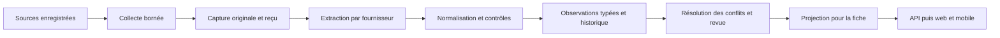

# Pipelines de données pour les fiches de projets et bâtiments

**Actualisation du 15 octobre 2026 :** les identités promoteur/projet, snapshots typés, typologies, équipements et références PDF/vidéo sont implémentés. Le [guide PROJECTS.md](PROJECTS.md) décrit les nouvelles tables, sources et pipelines, les captures externes pour gros fichiers et les pages traduites. Les offres de logements, plans de paiement, transcodages et traductions automatiques restent un lot ultérieur.

Cadrage du 13 octobre 2026, à partir de la demande de fiches immobilières comparables à la capture Proprobin. **Les nouveaux faits commerciaux décrits ici restent à développer.** Depuis ce cadrage, l'orchestration Prefect des imports existants a été implémentée dans une application dédiée ; voir [INGESTION.md](INGESTION.md). Les six présentations actuelles sont décrites dans [PROPERTY_EXPLORATION.md](PROPERTY_EXPLORATION.md).

## Résultat attendu pour le visiteur

La carte ouvre une fiche immobilière : nom, promoteur, photographie ou rendu autorisé, localisation, livraison annoncée, types de logements et principales informations commerciales. Les références cadastrales restent secondaires. Sur téléphone, une fiche compacte mène aux détails ; elle ne déplace pas la caméra au clic.

| Information | Première fiche compacte | Détails et précautions de sens |
|---|---|---|
| Nom, promoteur, localisation | Toujours prioritaires si documentés | Association géographique éventuelle distincte de l'identité commerciale acceptée |
| Photographie ou rendu | Visuel principal si droits établis | Distinguer photo réelle, rendu du promoteur et génération ; conserver auteur et date |
| Livraison annoncée | Par exemple « Q2 2029 » | Garder trimestre/année sans inventer un jour ; historique des reports ; annonce distincte de livraison effective |
| Types de logements | Appartement, duplex, penthouse, townhouse et chambres | Typologie du projet distincte d'un logement actuellement en vente |
| Prix indicatif | « À partir de… », avec nature et fraîcheur | Prix de lancement, offre commerciale, prix demandé et transaction réelle sont des séries distinctes |
| Plan de paiement | Résumé d'un plan applicable identifié | Plusieurs plans peuvent coexister ; conditions, échéances, remises et période de validité séparées |
| Surfaces et équipements | Quelques attributs utiles | Unités normalisées, valeur originale conservée ; pas de mélange entre terrain, surface intérieure et surface vendable |
| Plans et brochures | Accès depuis les détails | Projet, bâtiment et type de logement explicitement identifiés ; version du document |
| Disponibilités | Seulement avec inventaire daté | Le nombre total de logements d'un projet n'est pas le nombre restant à vendre |
| Transactions sur 30/90 jours | Phase suivante, sous réserve de données accessibles | Fenêtre, couverture, types de ventes, doublons et dernière ingestion définis ; donnée absente différente de zéro |
| Évolution des prix et rendement | Phase analytique suivante | Méthode, population comparable, coûts et période ; une projection marketing n'est pas un rendement observé |

Les sources et dates de chaque champ restent accessibles dans un volet de détails. Une fiche incomplète peut afficher ses données utiles ; les absences et contradictions ne sont pas masquées par une valeur inventée. Les noms de sources ne prennent pas la place des informations immobilières au premier écran.

## Vérification de sources réelles

Sources consultées le 13 octobre 2026 ; cette date de recherche n'est ni leur date de publication ni un reçu déjà importé.

- [The District — page officielle Reportage](https://reportagegroup.com/projects/residential-apartments/the-district/) : présente le projet, ses équipements et des liens de brochure, typologies et fiche technique. Elle annonce 874 logements et une hauteur de 82,5 m.
- [The District — fiche technique officielle](https://reportagegroup.com//wp-content/uploads/The-District-final-fact-sheet.pdf) : détaille des logements de une à quatre chambres, penthouses, duplex penthouses et townhouses. Ce programme total ne prouve pas une disponibilité commerciale actuelle. La surface de terrain annoncée, 14 605 m², est une observation du promoteur, distincte de la surface cadastrale Onwani ; elle ne doit pas écraser celle-ci.
- [The District — page d'offre du promoteur](https://reportagegroup.com/districtoffer/) : annonce une livraison au deuxième trimestre 2029, un prix de départ et plusieurs plans/remises. Les conditions d'offre, l'assiette de prix et l'inventaire concerné doivent être capturés avant tout affichage commercial. Les blocs dynamiques ne sont pas nécessairement présents dans une simple réponse HTML.
- [Proprobin — présentation publique](https://proprobin.com/) : indique utiliser des transactions ADREC pour son activité de ventes. L'accès de notre plateforme à ces données reste à qualifier ; le contenu du concurrent et sa capture ne constituent pas un jeu de transactions à importer.

La capture utilisateur sert à définir les informations et la présentation attendues. Son libellé « Not registered » sous « 90-Day Sales » n'établit pas que le projet n'est pas enregistré auprès d'une autorité. « Early Growth » n'est pas un fait administratif à recopier : tout indicateur similaire demande notre propre définition et ses données.

## Ce que le dépôt possède déjà

| Maillon | Code réel sur le poste | État |
|---|---|---|
| Collecteurs et orchestration | `C:\Users\Karim\Repositories\property-platform\apps\ingestion\src\property_platform_ingestion` | Prefect : neuf déploiements, collecte HTTPS bornée, horaires initiaux suspendus et reçus persistants |
| Validation cadastrale | `C:\Users\Karim\Repositories\property-platform\apps\api\src\property_platform\modules\evidence\onwani.py` | Service partagé par commande manuelle et orchestration, captures et audit |
| Couches spatiales et références | `C:\Users\Karim\Repositories\property-platform\apps\api\src\property_platform\modules\evidence\map_import.py` et `research_import.py` dans ce même dossier | Imports partagés, identités des fournisseurs conservées |
| Collecte des présentations | `C:\Users\Karim\Repositories\property-platform\apps\ingestion\src\property_platform_ingestion\collectors\properties.py` | Reçus des pages et médias examinés ; le script PowerShell historique reste disponible |
| Validation et stockage | `C:\Users\Karim\Repositories\property-platform\apps\api\src\property_platform\modules\evidence\property_protocol.py` et `property_import.py` | Empreintes, dates, identité exacte, droits ; lot atomique |
| Projection API | `C:\Users\Karim\Repositories\property-platform\apps\api\src\property_platform\modules\publication\map_preview.py` | Présentations courantes depuis la base |
| Fiche web | `C:\Users\Karim\Repositories\property-platform\apps\web\src\features\atlas\property-card.tsx` | Nom, promoteur/éditeur, lien, résumé, premiers médias et attributs OSM |

Les registres de présentations contiennent une revue éditoriale manuelle. Vérifier la présence de termes dans une page ne constitue pas un extracteur de livraison, de prix ou de plans de paiement. Ces attributs ne sont pas encore collectés automatiquement. Prefect est disponible pour les imports existants ; ses horaires préparés restent désactivés au premier enregistrement pour permettre une validation manuelle des sources.

## Chaîne à développer

1. **Déclarer la source** : fournisseur, territoire, URL ou API, identifiant exact du projet, droits, fréquence et budget. Un connecteur Reportage peut servir plusieurs projets et émirats ; la portée Reem est un paramètre d'acquisition, pas son identité technique.
2. **Collecter** : timeouts, taille maximale, cadence par hôte, réponses HTTP et heures réelles. Capturer les octets avant transformation. Les redirects et URL dérivées restent contrôlés ; une collecte n'accepte pas une URL arbitraire soumise par un visiteur.
3. **Extraire** : adaptateur propre à la famille de sources ; page, API structurée ou PDF. Un moteur générique de scraping ne devine pas les règles métier. L'OCR et le navigateur de rendu, s'ils sont nécessaires, s'exécutent séparément du web/API.
4. **Normaliser** : montants décimaux et devise, surfaces et unités, types de logements, nombres de chambres, livraison avec précision, étapes et conditions des plans. Préserver le texte original et un pointeur vers sa page/section/position.
5. **Contrôler** : bon projet, géographie, unités, intervalle de dates, devise, somme d'un plan complet et changements anormaux. Une capture incomplète ou un extracteur cassé ne remplace pas une ancienne valeur par du vide. Un plan partiel reste partiel.
6. **Conserver les observations** : chaque information a sa capture, sa provenance et sa version d'extracteur. Une nouvelle offre n'efface pas les anciennes ; un rapprochement incertain ne fusionne pas les identités.
7. **Choisir la valeur affichée** : règles par attribut, fraîcheur et portée, avec revue des contradictions. Une source officielle cadastrale est pertinente pour la parcelle ; un promoteur peut être la source primaire de sa livraison annoncée. Le rang ne dépend pas uniquement de la catégorie globale du site.
8. **Servir la fiche** : projection légère et typée, pagination et médias séparés. Le clic lit les données déjà préparées ; il ne lance aucune collecte distante, OCR ou génération.

## Modèles et responsabilités prévus

Les noms suivants sont des **cibles à concevoir et migrer**, pas des tables actuellement créées.

- `real_estate` / module `catalog` : identité commerciale de projet, relation acceptée projet–bâtiment, typologies et logements. Un projet peut avoir plusieurs bâtiments ; une empreinte OSM et un repère commercial ne suffisent pas à identifier un appartement. Les identités des sources restent liées par décisions réversibles.
- `evidence` : observations typées de livraison, programme de logements, équipements et documents, avec captures, pointeurs de preuve, extraction et revue. Réutiliser `Source`, `IngestionRun` et `Capture`. Le JSON reste adapté à la réponse originale, pas à un modèle universel de prix/date/identité.
- Domaine commercial à introduire avec les prix/plans : offres datées, observation de prix, plan et étapes, cible projet/typologie/unité, conditions et preuve. Documenter son propriétaire et les dépendances dans REPOSITORY avant d'ajouter ce module ; ne pas placer ces données dans un texte de résumé.
- `publication` : règles de projection, valeurs retenues et contradictions visibles ; l'API et les clients consomment les contrats générés. `publication` ne collecte pas et ne modifie pas directement les tables des autres domaines.

Pour chaque observation : identité source/cible, capture et emplacement de preuve, valeur typée, valeur originale, version d'extraction, date externe connue et précision, date de collecte et d'ingestion, portée/validité métier, statut de revue. Les heures appartiennent à leurs objets : ne pas dupliquer arbitrairement toutes les dates dans chaque table. Voir [DATA_PROVENANCE.md](DATA_PROVENANCE.md).

## Automatisation progressive et budget

Avec le budget initial inférieur à 500 AED/mois, l'application `apps/ingestion` exécute désormais les collecteurs dans un processus Python séparé avec Prefect auto-hébergé localement. Elle reste dans ce monorepo et réutilise les services Django ; l'API ne dépend pas de Prefect. Le suivi technique utilise une base Prefect séparée ; le registre métier durable utilise `evidence.ingestion_execution` dans PostgreSQL/PostGIS. Un coût d'hébergement n'a pas encore été engagé ou mesuré.

Les tâches et leurs tentatives doivent être persistées avec leur portée, version, état, résultat et prochaine échéance. Prévoir verrou/concurrence contrôlée, reprise après interruption, idempotence et réconciliation après résultat incertain. Une clé d'extraction associe identité de source, identité de cible, empreinte de capture et version d'extracteur ; les acquisitions identiques peuvent garder leurs dates de dernière vérification sans recréer des biens ou perdre la preuve précédente. Une réponse 304 ne remplace pas une capture par un payload vide.

Fréquences initiales à ajuster aux sources : attributs de projet quotidiens ou hebdomadaires ; offres plus fréquentes si un accès adapté existe ; inventaire selon son flux autorisé ; géométrie cadastrale à un rythme distinct. Respecter Retry-After et appliquer une temporisation progressive. Un 404 ou un échec ponctuel ne signifie pas que le projet ou l'offre a disparu.

L'interface Prefect affiche déjà déploiements, horaires, runs et journaux ; les résultats métier sont audités et les mises en quarantaine signalées. Ajouter progressivement les mesures de couverture, de fraîcheur et de budget consommé pour les nouveaux domaines. Les alertes externes sur un changement utile ou un connecteur en échec persistant restent à configurer.

Aucun besoin mesuré de Kafka, Airflow ou d'un cluster de traitements n'est établi pour ce pilote. Une queue plus élaborée viendra avec la concurrence et les traitements longs. Toute génération payante garde identité durable, réservation de budget et réconciliation avant réessai ; l'IA propose des extractions ou résumés avec preuve, sans devenir la source d'un prix ou d'une livraison.

## Ordre de réalisation et critères de fin

1. **Première tranche : faits immobiliers**. Commencer par The District, déjà identifié dans les données Reem : collecter sa fiche technique et sa page de projet, puis sa livraison annoncée via une source distincte. Implémenter observations typées, preuve par attribut, tests d'extraction et migration additive ; étendre le contrat et la fiche. Une deuxième source/projet valide que l'adaptateur ne dépend pas d'un seul nom codé en dur.
2. **Deuxième tranche : offres et plans**. Préciser nature des prix, cible, conditions et validité. Importer plusieurs plans sans les fusionner. Une typologie ou un total de logements ne crée pas d'inventaire disponible. Les logements précis attendent des identifiants et un flux de disponibilité fiable.
3. **Exécution programmée des nouvelles tranches**. Le socle Prefect, son runner et le registre durable sont désormais implémentés pour les imports existants. Brancher les nouveaux extracteurs et modèles sur cette fondation ; vérifier leurs répétitions, versions, interruptions et changements de parser. Aucun réessai automatique d'écriture n'est activé par défaut : la réconciliation du résultat précède la décision de relancer. Tester la concurrence et l'idempotence des futurs logements/offres avec leurs propres contraintes.
4. **Quatrième tranche : activité de marché**. Qualifier l'accès aux transactions ADREC et aux autres émirats, leurs droits et identifiants. Calculer les statistiques sur des fenêtres définies après rapprochement vérifié ; absence de couverture, aucune vente observée et zéro calculé sont trois états différents. Aucun indicateur de croissance ne doit précéder ses données et sa méthode.

Chaque tranche exige une validation PostGIS réelle pour les relations spatiales, des tests de contraintes/transactions pour les nouveaux modèles, la régénération des contrats, les quinze langues et le RTL, et un contrôle de la fiche avec données présentes, absentes, périmées ou contradictoires. Les premières captures et nouvelles migrations devront être appliquées explicitement ; compiler le site ne lance aucun import.

## État après la mise en place de l'orchestration

Le besoin et les sources pilotes sont documentés. L'orchestration des acquisitions existantes, neuf déploiements et deux tables d'audit supplémentaires sont implémentés ; leur installation locale est décrite dans [INGESTION.md](INGESTION.md). Aucun modèle projet/unité, prix structuré, échéancier, disponibilité, statistique de ventes ou nouveau média de promoteur n'est créé par cette orchestration. La prochaine extension immobilière doit livrer la première tranche complète, de l'acquisition à la fiche, avant d'élargir les métriques.
