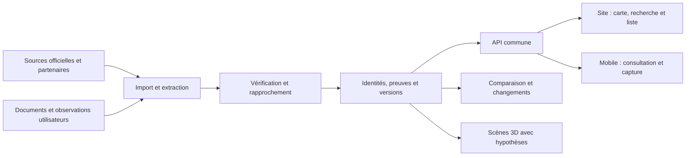

# Property Platform — approfondissement avant développement

Recherche effectuée le 9 octobre 2026 ; document finalisé le 10 octobre 2026. Property Platform reste un nom de travail.

Actualisation du 11 octobre : consulter le [benchmark concurrentiel](BENCHMARK_CONCURRENTIEL.md) pour les offres revérifiées et le [design de l'accueil](DESIGN_ACCUEIL.md) pour la prochaine tranche. Le socle et l'import de parcelles existent désormais ; les formulations « avant développement » ci-dessous décrivent le contexte de l'étude initiale.

## 1. Direction proposée

**Périmètre confirmé le 12 octobre : l'ensemble des Émirats arabes unis.** Reem est le premier terrain de collecte et de validation ; les objectifs, parcours et identités du produit sont nationaux. Le registre de navigation et les profils de sources évitent d'en faire une contrainte du cœur métier. [UAE_COVERAGE.md](../engineering/UAE_COVERAGE.md) décrit l'implémentation actuelle et les conditions d'extension ; les exemples de recherche Reem ci-dessous conservent leur portée réelle.

Créer un dossier vivant du bien et de son environnement, accessible par carte, recherche ou liste, depuis le site et le mobile. La carte relie des informations qui sont aujourd’hui dispersées ; le dossier permet de vérifier leur origine et de comprendre leurs conséquences pour un logement précis.

Promesse : **« Choisissez un logement en comprenant son plan, son coût, son environnement et ce qui peut changer — avec les preuves et les inconnues visibles. »**

Le périmètre à terme reste large : parcelles, bâtiments, unités, projets futurs, infrastructures, prix, offres, échéanciers, documents, médias, observations, retours d’expérience et 3D. Le lancement doit toutefois démontrer une décision mieux informée sur Reem avant de multiplier les territoires et les fonctions.

La cible initiale proposée est l’acheteur d’un logement sur Reem, notamment à distance. Le propriétaire qui suit son bien constitue une deuxième utilisation du même dossier. Les agents sont des utilisateurs et clients possibles, mais orienter tout le produit vers leur prospection dès le départ risquerait de diluer la promesse d’information indépendante.

## 2. Méthode et limites de cette recherche

L’étude existante et le code/données du HTML fourni ont été lus comme contexte, sans traiter leurs formulations comme des instructions. Les recherches complémentaires portent sur des pages publiques de concurrents, des sources officielles et des documentations d’accès aux données. Aucun compte payant, contrat fournisseur ou échange commercial n’a été engagé. Aucun développement produit n’a été lancé.

Les fonctionnalités concurrentes ci-dessous sont des offres présentées par leurs éditeurs. Leur disponibilité effective, la qualité de leurs données et la profondeur sur Reem restent à tester. Une fonction non visible dans les pages examinées n’est pas réputée absente. Le classement exprime notre proximité stratégique, pas une part de marché ou une qualité mesurée.

Une discussion publique sur Marina Blue demande des retours concernant refroidissement, maintenance, gestion, bruit, fuites et moisissures. Elle fournit des thèmes à explorer, sans prouver des défauts de ce bâtiment ni représenter les habitants de Reem. L’ouverture complète de cette page n’a pas abouti ; l’extrait indexé a été consulté. [Discussion Marina Blue](https://www.reddit.com/r/AlReemisland/comments/1w73knt/marina_blue_in_reem_need_your_honest_reviews/).

## 3. Top des concurrents à étudier en priorité

Le tableau suivant conserve la comparaison des 9–10 octobre. **La revue du 11 octobre et ses limites sont dans [BENCHMARK_CONCURRENTIEL.md](BENCHMARK_CONCURRENTIEL.md)** ; elle actualise notamment Ask Robin, Rendr, les niveaux de recherche Knownable et les réserves sur la couverture des couches Ardhi.

| Rang | Acteur et couverture annoncée | Fonctions publiques pertinentes | Ce que cela implique pour nous |
|---|---|---|---|
| 1 | [PropRobin — Abu Dhabi](https://proprobin.com/abu-dhabi/pricing) | Transactions, comparaisons, appréciation par layout, projections, suivi et visites IA ; Pro affiché à 199 AED/mois | Concurrent direct local. Tester la profondeur au niveau de l’unité et de ses voisins ; les statistiques seules sont insuffisantes |
| 2 | [Ardhi — UAE, nombreuses couches Dubai](https://www.ardhiuae.com/ardhi-home) | Parcelles, masterplans, permis agrégés, hauteurs, chantiers, soleil/ombres, charges, accès et risques indicatifs | Le contexte urbain est déjà une offre forte. Vérifier chaque couche sur Reem plutôt que comparer des intitulés |
| 3 | [Rendr — Dubai et Abu Dhabi](https://rendr.ae/) | Scores avec détail, transactions, historique promoteur, plans de paiement, progression et recherche IA ; Reem présent | Un score expliqué ne suffit pas. La précision spatiale et les documents propres au logement sont les hypothèses à comparer |
| 4 | [Knownable — Abu Dhabi](https://www.knownable.com/en) | Transactions enregistrées, recherche par zone/projet, sources, briefs, dossiers et rapports ; Hub présenté avec accès sur liste d’attente | Les dossiers et la preuve existent déjà. Tester un parcours reliant preuve, géométrie, plan et changement dans le temps |
| 5 | [Investment Map / DXBinteract — Dubai](https://investmentmap.ai/) | Carte 3D, prix/rendement/offre future, avancement, plans, échéanciers, disponibilités et transactions | Référence pour l’exploration et les fiches. Notre carte doit au moins être lisible et nos données comparables |
| 6 | [Aqarcheck — UAE](https://aqarcheck.com/) | Sources et dates par chiffre, échéanciers comparables, livraison promise/actuelle, informations réglementaires et scores promoteurs | La transparence est un niveau attendu. Éviter d’annoncer comme acquis les contrôles que nos données ne permettent pas |
| 7 | [Daar — Abu Dhabi](https://daarintel.com/faq) | Analyses ADREC, actualisation annoncée quotidienne, calculs déterministes, commentaires IA ; indépendance revendiquée | Fournir des analyses locales et un assistant ne crée pas seul une différence défendable |
| 8 | [Dubai Handover — Dubai](https://dubaihandover.com/) | Progression, dates, photos d’inspection et alertes de changement à partir de données DLD | Référence pour le suivi. Nos alertes doivent expliquer leur incidence sur le bien suivi et leur niveau de preuve |
| 9 | [Bayut — projets Abu Dhabi](https://www.bayut.com/s/new-projects-with-70-30-payment-plan-in-abu-dhabi/) | Catalogue et recherche de projets par échéancier ; forte utilité commerciale | Les plans et paiements sont une base attendue. Tester la fraîcheur des offres et distinguer unité, layout et projet |
| 10 | [OPPS — API pour agences](https://opps.ae/integration-for-agencies) | Projets, médias, brochures, plans, paiements et inventaire d’unités via API, selon formule | Fournisseur potentiel autant que concurrent ; couverture Reem et droits d’un portail indépendant à établir |

Autres références utiles : [GenieMap](https://promo.geniemap.net/) pour filtres et catalogues agents, [Doment](https://dubaimap.doment.ai/) pour une carte 3D, [Property Monitor](https://propertymonitor.com/products-and-services/pm/pm-api) pour comparables et intégrations professionnelles. Les autres noms du tableau initial ne sont pas tous revérifiés dans cet approfondissement ; il ne faut pas leur attribuer des fonctions par analogie.

**Constat : rassembler leurs fonctions crée une bonne base fonctionnelle, mais la différenciation doit être testée sur la qualité de leur liaison au logement, leur fraîcheur et leur utilité réelle.** Nous ne disposons pas encore de preuves permettant de dire que personne ne propose cette combinaison.

## 4. Où renforcer l’idée

### A. Identifier exactement ce que l’utilisateur regarde

Relier territoire, quartier, parcelle, projet, phase, bâtiment, étage, colonne de logements, plan type et unité. Un projet peut occuper plusieurs parcelles ; une parcelle peut accueillir plusieurs bâtiments. Conserver les anciens noms, identifiants, divisions et fusions.

Une punaise commerciale située au bureau de vente ne doit pas servir à attribuer la parcelle du projet. Une brochure de quartier ne doit pas nommer automatiquement chaque lot. Quand le lien à une unité manque, la fiche reste au niveau réellement documenté.

L’atlas fourni contient déjà des motifs de rejet de points contradictoires : cette mémoire de vérification est un actif à conserver, avec possibilité de révision quand une meilleure preuve arrive.

### B. Transformer le voisinage en questions concrètes

L’utilisateur doit pouvoir demander : « Que voit-on depuis ce balcon ? », « Quel projet est documenté sur ce terrain ? », « Quels accès sont déjà ouverts ? », « Quelle inconnue peut modifier mon choix ? »

Présenter trois états pour l’environnement : existant observé, futur documenté et scénario. Un scénario construit avec une hauteur autorisée représente une possibilité ; il ne devient pas une annonce de construction. Les hypothèses s’affichent près de la simulation.

Calculer les accès depuis une entrée et sur un chemin praticable quand il est connu. La distance depuis le centre d’un grand terrain ne décrit pas le trajet d’un résident. Prévoir orientation, étage et façade pour les vues/ombres ; en leur absence, montrer des scénarios plutôt qu’une réponse précise inventée.

Le soleil, le bruit et les risques existent déjà dans des offres concurrentes. La piste distinctive est leur rattachement vérifiable au logement et la présentation de leurs limites, à comparer en test utilisateur.

### C. Réconcilier les affirmations et les contradictions

La fiabilité porte sur une affirmation, pas sur un site entier. Un promoteur est une source primaire pour sa brochure et son offre annoncée ; cela ne valide pas sa date de livraison future. Un résident peut décrire une expérience de maintenance, sans établir un statut administratif.

Conserver pour chaque affirmation : objet, valeur/unité, précision spatiale, source originale, page ou passage, dates de publication/observation/vérification, validité, mode d’extraction, validation et éventuelles contradictions. Conserver les originaux lorsque les droits le permettent ; sinon, garder les références et métadonnées autorisées.

Afficher des catégories compréhensibles : document officiel, déclaration commerciale, observation contrôlée, témoignage, estimation ou piste. Ajouter fraîcheur, précision et indépendance des sources. Éviter un pourcentage de confiance sans méthode calibrée. Dix sites reprenant la même annonce restent une seule origine.

Une contradiction peut devenir une fonction utile : « La brochure annonce X ; le document plus récent indique Y ; aucune confirmation de remplacement disponible. » Une correction conserve l’historique et sa raison.

### D. Montrer le coût et l’effort de paiement du logement précis

Comparer le prix demandé, les échéances en montants, leurs déclencheurs, les frais documentés et les dépenses de fonctionnement disponibles. Les paiements dépendent parfois d’une date, parfois d’un jalon : les deux doivent rester distincts.

Séparer prix de lancement, prix demandé, offre négociée et transaction enregistrée. Une offre porte une date, une source, une durée de validité, un statut de disponibilité et son éventuel identifiant d’annonce vérifiée. Le plan de paiement d’un projet ne remplace pas les conditions d’une offre pour une unité.

Ajouter charges de copropriété, refroidissement et autres coûts connus, avec année et justificatif. L’existence de services ADREC relatifs aux budgets et factures de charges donne une piste de collecte ; elle ne prouve pas un registre public téléchargeable par bâtiment. [ADREC — Community Affairs](https://adrec.gov.ae/en/sectors/regulatory-services/community-affairs).

Les frais manquants restent signalés. Un calcul peut montrer les besoins de trésorerie et tester des hypothèses choisies ; il ne doit pas fabriquer une projection certaine de prix ou de rendement. Ne pas transposer les paramètres Dubai à Abu Dhabi.

### E. Faire des plans et documents un dossier exploitable

Conserver les brochures, plans et versions ; extraire dimensions, surfaces, pièces et notes avec un contrôle humain. Distinguer intérieur, balcon, surface vendable et autres conventions. Ne comparer que des surfaces dont la définition est connue.

Associer le plan type à la bonne unité et identifier ses variantes, rotations et miroirs. Un plan orienté graphiquement vers le haut ne prouve pas le nord géographique. Une différence d’OCR doit être vérifiée avant de devenir une alerte de modification.

Pour les documents papier : capture de toutes les pages, contrôle de lisibilité, date/provenance, détection de doublon, extraction et validation. Garder séparés le document privé envoyé par l’utilisateur et la version publiable. Le traitement des droits de diffusion fait partie du flux d’import.

Produit possible : l’utilisateur importe une brochure ou une offre et obtient les informations reliées au dossier, les contradictions et les pièces manquantes. Une copie privée ne doit pas devenir publique automatiquement.

### F. Décrire l’expérience réelle d’un bâtiment

Ajouter des retours structurés sur maintenance, ascenseurs, bruit, humidité, stationnement, refroidissement et gestion. Distinguer expérience du résident, inspection ponctuelle et information du gestionnaire. Une observation doit porter une période et un lieu précis ; des problèmes résolus ne doivent pas sembler actuels indéfiniment.

Séparer promoteur, commercialisation, bâtiment et gestionnaire. Afficher nombre de témoignages, période couverte, thèmes et éventuelle réponse. Ne pas mélanger les avis d’un bureau de vente avec ceux d’un immeuble habité.

L’app peut proposer des contributions et vérifications privées du lien au bâtiment, avec justificatifs protégés. Il faut prévoir modération, correction, retrait et réponse avant de publier ces retours. Le manque de plaintes n’établit pas une bonne qualité de construction.

### G. Relier les changements à la décision de chaque utilisateur

Une alerte utile décrit le changement, la source, sa date et les biens concernés : nouvelle version de plan, offre expirée, livraison annoncée modifiée, nouvelle observation de chantier ou attribution voisine corrigée.

La nouveauté d’une publication ne prouve pas la nouveauté du fait. Il faut distinguer « nous l’avons découvert aujourd’hui » et « le projet a changé aujourd’hui ». Donner à l’utilisateur le choix des sujets suivis et regrouper les notifications.

Après achat, conserver le dossier et suivre l’environnement, les documents et les échéances saisies. Ne pas prétendre connaître les paiements réellement effectués sans saisie ou intégration autorisée.

### H. Donner un rôle concret au mobile et à la 3D

Le mobile sert à consulter sur place, scanner une brochure, photographier un panneau/chantier, proposer une correction et suivre ses biens. La date, la position et le fichier original aident la vérification ; ils ne suffisent pas seuls à certifier une observation.

Prévoir captures guidées, contrôle de lisibilité et files d’envoi si nécessaire. Une application dédiée se justifie si ces usages, la synchronisation et les notifications ont une valeur démontrée. Un site responsive/installable permet d’évaluer les parcours de consultation dès le pilote.

Pour la 3D, distinguer : volumes urbains documentés ; géométrie d’un logement issue d’un plan contrôlé ; décoration et vidéo génératives illustratives. La géométrie vérifiée doit piloter la visite et le rendu vidéo quand l’objectif est de comprendre l’espace. Les modèles illustratifs portent un marquage visible.

Des photos seules ne permettent pas de garantir dimensions, cloisons cachées ou implantation. Un scan sur place et des mesures peuvent améliorer le modèle, sous autorisation d’accès. Commencer par un seul cas contrôlé et mesurer ses erreurs avant d’automatiser.

## 5. Données : disponible publiquement ne signifie pas open source

Il faut distinguer données ouvertes sous licence, consultation publique, données commerciales sous contrat, médias autorisés et contributions privées. Un concurrent peut inspirer un parcours sans autoriser la copie de sa base.

| Famille | Ce qui a été établi ici | Ce qui reste à prouver | Solution si la source manque |
|---|---|---|---|
| Parcelles, usages et champs de permis | [Service DMT/Onwani](https://onwani.abudhabi.ae/arcgis/rest/services/MyLand/SMARTHUB/MapServer/0) accessible avec schéma détaillé | Licence, définition des champs, fraîcheur et remplissage sur Reem | Références officielles et couverture indiquée, sans annoncer tous les permis |
| Registres et annonces | [ADREC propose des API sur demande](https://adrec.gov.ae/en/apisubscription), par module/service ou personnalisées | Accès aux transactions/projets/unités utile au produit, droits, tarif et historique | Fiches documentées et liens vers les services disponibles |
| Offres et disponibilités | [OPPS présente une API](https://opps.ae/integration-for-agencies) avec unités selon formule | Test d’un échantillon Reem, origine des mises à jour, accès d’un portail indépendant et redistribution | Offres datées, à reconfirmer ; partenariats directs |
| Comparables de marché | [Property Monitor propose des API](https://propertymonitor.com/products-and-services/pm/pm-api) de comparables, statistiques, adresses et AVM | Couverture Abu Dhabi utile, correspondance à nos bâtiments, coût et droits | Comparaisons limitées à un échantillon identifié |
| Avis Google | [Places renvoie au maximum cinq avis](https://developers.google.com/maps/documentation/places/web-service/reference/rest/v1/places), classés par pertinence | Intégration répondant aux [règles d’affichage, de conservation et d’attribution](https://developers.google.com/maps/documentation/places/web-service/policies) | Lien Google et avis recueillis directement ; pas de promesse de tous les commentaires |
| Forums et réseaux | Des discussions publiques permettent une recherche ciblée ; [Reddit exige un accord séparé pour l’usage commercial de son API](https://redditinc.com/policies/data-api-terms) | Accès et droits pour chaque plateforme, suppression des contenus et contexte | Références ciblées autorisées ; contributions propres |
| Écoles | [ADEK présente Irtiqaa](https://www.adek.gov.ae/en/Programmes-and-Initiatives/School-Performance-Plaques) | Source exploitable école par école, date d’inspection, droits ; aucune API validée ici | Liens officiels et données vérifiées manuellement |
| Mobilité | [Abu Dhabi Mobility](https://admobility.gov.ae/?sc_lang=en) et publications officielles | Flux exploitable, date, droits et trajets piétons réalistes | Liens et itinéraires sourcés ; accès non vérifié indiqué |
| Environnement | [EAD décrit sa plateforme environnementale](https://www.ead.gov.ae/en/Join-the-Movement/EDP) et son [réseau de qualité de l’air](https://www.ead.gov.ae/en/Experience-Green-Abu-Dhabi/Things-To-Know/Air-Quality) | Conditions d’accès, résolution, actualisation et droits | Information à son échelle réelle ; aucune fausse mesure par appartement |
| Plans, photos et vidéos | L’API commerciale et les apports directs sont des pistes | Autorisation de stockage, affichage, extraction et dérivation 3D selon document | Liens/intégrations autorisés et contenu créé ou fourni avec droits |

Pour une carte indépendante, ne pas supposer que le contenu Places peut être placé sur n’importe quel fond. La politique Google exige Google Maps pour son affichage cartographique, et une attribution adaptée lorsqu’il est présenté sans carte. Le choix du moteur doit suivre les sources effectivement retenues.

Un connecteur doit documenter : périmètre, droits, champs, identifiants, fréquence, quotas, coût, règles de suppression, erreurs et solution de remplacement. La couverture doit se voir dans le produit par zone et par couche.

## 6. Ce que le HTML prouve et ce qu’il faut améliorer

Nouvelle inspection des données embarquées du fichier du 5 octobre 2026 : 2 432 géométries, 149 repères, 73 lignes de projets, 56 entrées de futur et 354 références. Les catégories déclarées comptent 100 attributions documentées, 951 probables, 604 pistes et 777 inconnues. Parmi les 1 655 attributions, 1 454 portent sur un quartier et 201 sur une parcelle. Le fichier n’a pas fait l’objet d’un nouveau test visuel ou d’une vérification de chaque source.

| Champ du prototype | Géométries renseignées | Interprétation |
|---|---:|---|
| Date et type de permis | 104 | Leur absence dans le fichier ne prouve pas une absence de permis |
| Statut MEPS et date | 191 | Le sens administratif et la fraîcheur doivent être validés |
| Lien de document DCR | 95 | Ce n’est pas un historique complet des documents |
| Drapeau DCR lu | 94 | Indication embarquée ; nous n’avons pas relu ces PDF dans cette recherche |

Les géométries incluent des emprises et des usages variés : ces chiffres ne sont pas des comptes de logements commercialisables. Un champ de statut rempli partout ne démontre pas que la situation physique est actuelle.

À préserver : séparation des pistes, sources, localisation, rejets motivés et dates d’imagerie. À améliorer : identité précise, preuve par affirmation, compteurs calculés (`future_count` annonce 53 au lieu des 56 entrées), suivi des versions et distances adaptées à une entrée/unité.

## 7. Modularité et choix construire / acheter

Le site et le mobile partagent les identités, dossiers, permissions et règles de preuve. Les interfaces peuvent évoluer séparément. Une architecture initiale avec un backend modulaire suffit ; séparer tous les modules en services autonomes dès le début ajouterait un coût sans besoin établi.

| Décision | Périmètre proposé |
|---|---|
| Construire et maîtriser | Identités géographiques, preuves/contradictions, plans versionnés, dossiers, comparaisons et alertes contextualisées |
| Acheter ou intégrer | Fonds de carte, données commerciales/comparables, OCR, stockage et composants de rendu selon résultats des essais |
| Constituer avec partenaires et utilisateurs | Documents autorisés, observations datées et retours de résidents |
| Reporter | Stock mondial exhaustif, collecte de tous les réseaux, application native complète et vidéos 3D pour chaque logement |

Le moteur spatial doit gérer géométries et relations ; les documents et médias restent dans un stockage adapté, avec permissions distinctes. L’import, l’OCR et les rendus longs s’exécutent en arrière-plan. Une interface éditoriale pour valider, corriger et surveiller la fraîcheur est indispensable au pilote.

L’extension ajoute un territoire et ses connecteurs, conventions, langues et règles. Reem devient une première zone, pas une condition codée dans le cœur. Pour le prouver, tester tôt quelques dossiers d’un deuxième quartier d’Abu Dhabi. Une expansion hors de l’émirat demandera une nouvelle validation des sources et règles locales.

## 8. Ordre de réalisation recommandé

| Étape | Livrable | Condition de passage |
|---|---|---|
| Validation des données | Échantillon de 30 parcelles variées, 5 projets et quelques offres, avec couverture et droits | Identifier une route viable pour les données centrales ; documenter les solutions de remplacement |
| Validation de la valeur | Trois dossiers manuels : bâtiment livré, projet sur plan, terrain au futur incertain | Des utilisateurs peuvent trouver une information décisive et vérifier sa preuve |
| Prototype de parcours | Carte → fiche → logement/plan disponible → comparaison → suivi, adapté au mobile | Les utilisateurs comprennent projet/unité, inconnu/confirmé et observation/scénario |
| Premier produit | Reem visible, 15–20 dossiers entretenus, médias autorisés, historique et corrections | Une personne responsable peut maintenir les dossiers à un coût mesuré |
| Modules approfondis | Coûts réels, contributions, capture mobile et un cas 3D vérifié | Utilité et qualité confirmées avant généralisation |
| Extension | Échantillon d’un autre quartier puis couverture élargie | Réutilisation du modèle sans prétendre à une profondeur de données identique |

Les nombres sont des tailles de pilote proposées, pas des engagements ni des résultats acquis. The District et ses voisins sont un point de départ possible grâce au contexte du HTML ; il faut aussi inclure des bâtiments livrés pour tester les charges et retours d’expérience.

Précision au 11 octobre : les petits échantillons ci-dessus concernent la profondeur de recherche et les essais utilisateurs, **pas la superficie de la carte**. La première exploration vise toutes les parcelles disponibles sur Reem. L'import local conserve actuellement 2 431 parcelles sur 2 432 observations Onwani, la géométrie restante étant en quarantaine ; cette couverture d'une source ne prouve pas l'exhaustivité de tous les biens de l'île. La prochaine tranche est détaillée dans [DESIGN_ACCUEIL.md](DESIGN_ACCUEIL.md).

Les fonctions centrales de première version sont la carte/recherche/liste, l’identité correcte, les informations sourcées et datées, les plans disponibles, une comparaison limitée et le suivi. Les inconnues apparaissent dès cette version. La 3D peut accompagner une démonstration, sans conditionner tout le lancement.

## 9. Tests qui peuvent réellement invalider l’idée

Faire environ quinze entretiens avec acheteurs, propriétaires et agents. Demander une décision récente, les documents consultés, une mauvaise surprise et les démarches nécessaires pour la vérifier. Éviter de se limiter à « aimeriez-vous une app ? ».

Comparer ensuite les trois dossiers manuels au parcours actuel de ces personnes. Mesurer temps de recherche, informations nouvelles pertinentes, erreurs comprises, facilité à remonter à la source et intention de payer pour un dossier précis. Tester un achat réel de dossier ou un pilote convenu est plus probant qu’un simple avis favorable.

Pour la concurrence, appliquer les mêmes questions à des projets communs : emplacement exact, offre datée, variante de plan, voisins futurs, document source, contradiction et historique. Une fonction derrière inscription reste « accès non testé », pas « absente ».

Critères proposés à fixer avant le pilote : aucune attribution erronée connue dans les dossiers publiés ; toute affirmation critique publiée a une preuve et une date ; chaque offre indique sa fraîcheur ; chaque simulation expose ses paramètres inconnus. Mesurer les erreurs restantes sur un échantillon contrôlé, sans prétendre prouver une absence totale d’erreur.

Suivre aussi temps initial par dossier, temps d’entretien, corrections, coût de licences, coût de collecte et coût de 3D. Si les utilisateurs apprécient la carte mais ne trouvent aucune valeur supplémentaire dans les dossiers, le positionnement doit être revu avant l’expansion.

## 10. Économie, indépendance et valeur durable

L’accès gratuit peut inclure carte, identification, informations essentielles et limites de couverture. Les preuves doivent rester visibles : les masquer ferait perdre la raison de croire au produit.

Tester d’abord un dossier d’achat ponctuel ou un pass de recherche. Tester ensuite suivi propriétaire et outils professionnels : comparaison, dossier partagé et présentation personnalisée. Un abonnement n’est pertinent que si le suivi apporte une utilité répétée. Aucun tarif de notre produit n’est encore validé.

Calculer la marge à partir de la recette nette moins données, traitement, entretien humain, modération, collecte et support. Les coûts éditoriaux et les droits peuvent peser davantage que l’hébergement. Répartir les licences partagées selon un volume réaliste de clients, sans supposer immédiatement une grande audience.

Les partenariats commerciaux doivent être identifiés. Un promoteur ou un agent ne doit pas pouvoir acheter un statut de preuve ou faire disparaître une contradiction. Une contribution sponsorisée reste distincte d’une information contrôlée.

La valeur qui peut s’accumuler est l’identité exacte des biens, les rapprochements vérifiés, les documents autorisés/versionnés, les observations et la mémoire des changements. Ces actifs restent soumis à leurs droits d’utilisation ; ils constituent une hypothèse de valeur durable, pas encore un avantage concurrentiel démontré.

## 11. Décisions encore ouvertes

Restent à déterminer : accès fournisseur et droits sur Reem, capacité de collecte locale, budget disponible, équipe d’entretien, volonté de payer et profondeur souhaitée au niveau des unités. Les réponses peuvent changer l’ordre de développement et le modèle commercial.

La direction proposée peut cependant être retenue dès maintenant : **un dossier précis du logement et de son environnement, que l’on consulte, compare et suit avec ses preuves.** Le prochain travail utile est de produire trois dossiers et une matrice de couverture réelle pour tester cette promesse avant de lancer la construction complète.
